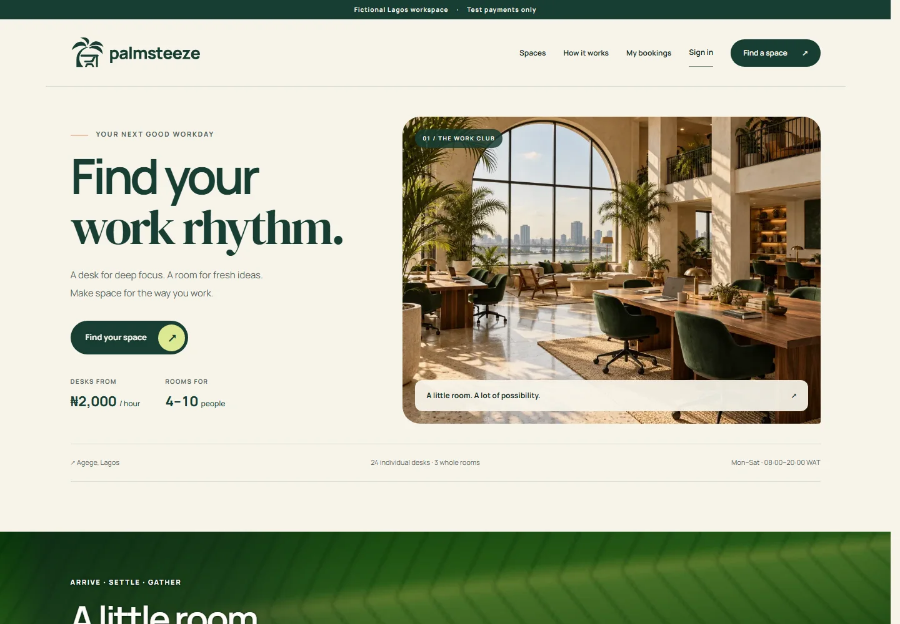
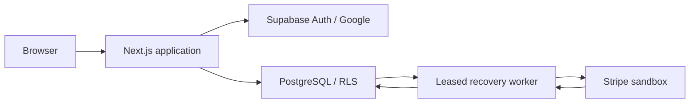
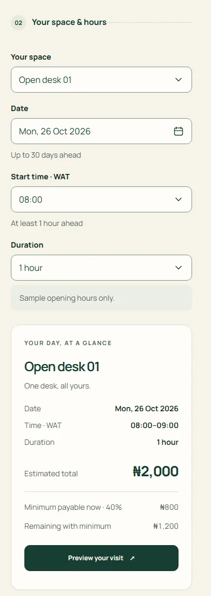
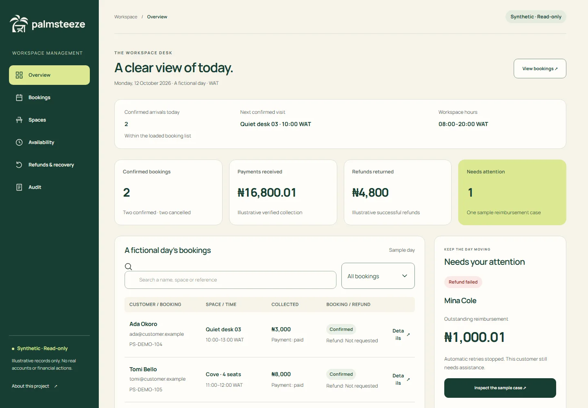

<p align="center">
  <picture>
    <source media="(prefers-color-scheme: dark)" srcset="public/brand/v2/primary-horizontal-ivory.svg">
    
  </picture>
</p>

# PalmSteeze

A coworking booking demo set in an imagined workspace in Agege, Lagos. Choose a desk or meeting room, plan a visit, sign in with Google and follow a sandbox payment through confirmation, cancellation and refund recovery.

[Explore the demo](https://palmsteeze.devs.surf) · [Run locally](#run-locally) · [Architecture](documentation/architecture.md) · [Contribute](CONTRIBUTING.md)

[](https://nodejs.org/)
[](https://nextjs.org/)
[](https://react.dev/)
[](https://www.typescriptlang.org/)
[](https://supabase.com/)
[](https://stripe.com/)



*The actual application with synthetic inventory. Interior images illustrate a fictional venue.*

## What you can try

- Select one of 24 individual desks or three whole meeting rooms, with 44 seats in total. Dates and hours use Africa/Lagos time.
- Review availability and an authoritative quote, then pay the 40% minimum deposit, a higher amount or the full total in Stripe's sandbox.
- Return from Google sign-in with your visit selection intact, revisit bookings and resume an unfinished Checkout.
- Follow cancellation decisions and verified refund progress. Approval and completed reimbursement are separate states.
- Explore a [read-only administration preview](https://palmsteeze.devs.surf/preview/admin) with synthetic records. Actual administration requires an assigned role.
- Choose necessary-only storage or allow tab-scoped visit memory, and revisit that choice in Cookies & storage.

There is no real venue or live payment service. Google sign-in can use real account information; read the [privacy notice](https://palmsteeze.devs.surf/privacy) before signing in. Entrance verification protects the application, while its introduction and legal pages remain public.

## Run locally

The exercised development workflow is **Windows x64 with PowerShell**, using isolated Node **24.21.0** and npm **11.19.0**. Git and internet access are needed for initial downloads.

```powershell
git clone https://github.com/S-Adnan-11/palmsteeze.git
cd palmsteeze
./scripts/bootstrap-runtime.ps1
./scripts/npm.ps1 ci
./scripts/npm.ps1 run dev
```

Open **http://localhost:3000**. The public introduction is the first successful result; keep the terminal open and press **Ctrl+C** to stop the server. It binds to loopback.

For configuration, copy `.env.example` to `.env.local` if you do not already have one. The introduction works without service credentials. The full planner requires entrance verification; Google sign-in, reservations and payments also require configured services. Missing Supabase configuration selects synthetic inventory; a configured service failure displays an unavailable state.

See [development and configuration](documentation/development.md) for test-widget setup, environment groups, test selection and troubleshooting. Database tooling targets a dedicated Supabase development project, rather than installing a generic local database.

## How it works



We keep prices, ownership, inventory conflicts and durable payment history in PostgreSQL. Next.js validates requests and verifies identity. The worker reconciles signed events and provider reads even if the browser closes. A Checkout return URL never establishes payment success.

Stored and calculated money uses integer kobo; the interface displays naira. Booking snapshots retain the terms agreed at creation, including older deposit percentages. Database exclusion constraints prevent overlapping active allocations, and single-use capabilities bind reservations to a verified user and selection.

| Technology | Role |
| --- | --- |
| Next.js App Router, React, TypeScript | Server-rendered pages, interactive controls and HTTP boundaries |
| Tailwind CSS 4 and scoped CSS | Responsive layout, typography and motion preferences |
| Radix Popover/Select, React DayPicker | Keyboard-aware grouped controls and the branded calendar |
| Supabase Auth, PostgreSQL, `pg` | Google sessions, ownership policies, transactions and database tooling |
| Cloudflare Turnstile | Separate server-validated entrance and reservation checks |
| Stripe sandbox | Hosted test Checkout, signed events and refund records |
| Three.js and Anime.js | Offline scene rendering; the public section plays self-hosted video |
| npm, ESLint, tsx, Playwright, axe-core | Locked installation, static checks, units and browser verification |

See the [architecture reference](documentation/architecture.md) and [asset notes](documentation/assets.md).

## A smaller screen



*Chrome mobile emulation; this image does not establish physical-device compatibility.*

<details>
<summary>See the read-only administration preview</summary>



The preview uses invented records and has no access to real accounts or financial actions.

</details>

## Development checks

```powershell
./scripts/npm.ps1 run typecheck
./scripts/npm.ps1 run lint
./scripts/npm.ps1 test
./scripts/npm.ps1 run build
./scripts/npm.ps1 run start
```

The last command serves the production build at **http://localhost:3000**; stop development first to free port 3000. The validation workflow runs installation, type checking, lint, units and a build without service credentials. It does not publish the application.

Database and authenticated browser tests need dedicated credentials and can create records or sandbox payments. Use the [test guide](documentation/development.md#testing) to select a suite and isolate fixtures. Emulated browsers, official test keys and controlled provider responses each have different limits.

## Source and delivery

`main` is the maintained source branch. The hosted demo's application baseline is [`a11ba0b`](https://github.com/S-Adnan-11/palmsteeze/commit/a11ba0bb46e965802189d0dbf1e81deafa892e21); `main` includes that application and later maintenance work. A source commit and deployed artifact are separate facts.

The existing Vercel workflow publishes manually from a checked commit. `vercel.json` disables automatic Git deployments. [Deployment documentation](deployment/README.md) explains the build environment, archive command and verification steps. Supabase migrations and the payment worker have separate lifecycles from a frontend deployment.

## Limitations

This personal demonstration has no availability guarantee. Payments remain sandbox-only; uncertain payments and failed refunds require reconciliation. There is no automatic account purge or alternate reimbursement service.

The silent workspace video autoplays while visible and pauses offscreen or in hidden tabs. Reduced motion displays a matching poster; denied autoplay falls back quietly. Continuous motion has no manual pause control. The project does not claim full accessibility conformance or complete physical-phone, Safari or Firefox coverage.

## Contributing, contact and license

Report reproducible bugs through [GitHub Issues](https://github.com/S-Adnan-11/palmsteeze/issues), with versions and sanitized steps. Never post account records, session traces, credentials or card details. Read [CONTRIBUTING.md](CONTRIBUTING.md) before changing data or payment code.

First-party code and developer documentation use the [MIT License](LICENSE). PalmSteeze logos and visual assets are excluded from that grant; third-party assets retain their own terms. See [asset licensing](documentation/assets.md#licensing-boundaries) and bundled [third-party notices](public/licenses/third-party-notices.txt).

 [Adnan Muhammad Sadiq](https://s-adnan.dev)
