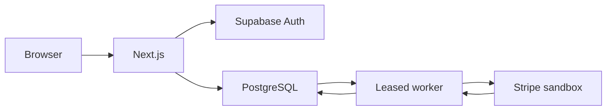

# PalmSteeze

A personal coworking-booking project by **Adnan Muhammad Sadiq**, inspired by looking for a coworking space after coming to Lagos and asking friends for recommendations. The project explores payment architecture through a clear customer journey.

The imagined venue is in **Agege, Lagos**. It has 24 individually bookable desks and three whole meeting rooms: 27 resources and 44 seats. There is no real venue, street address or live payment service. Stripe stays sandbox-only; Google account data can still be real.

Hosted sandbox demo: **https://palmsteeze.devs.surf**, application revision `a11ba0bb46e965802189d0dbf1e81deafa892e21`, deployment `dpl_FxULDStojM4ab8Q82VtntbBT3AyB`, verified READY on 24 October 2026. Anonymous visitors can read the app's purpose and Google-data use at `/` without JavaScript or security clearance; entering the full application still requires verification. The owner confirmed genuine Turnstile and Google sign-in on a phone browser, Search Console DNS CNAME ownership and verified Google branding. Independent hosted checks verify Google presentation, PKCE and callback cancellation with saved selection. The complete hosted saved-selection/payment/history/admin journey and broader phone acceptance remain separate walkthroughs. Current SEO stays unchanged until the planned **4 November 2026** review.

## What it demonstrates

- Resource/date/hour selection, accessible grouped selectors and a branded Lagos-date calendar.
- Supabase-mediated Google OAuth with PKCE and saved allowed destinations.
- Authoritative PostgreSQL prices, integer kobo and naira display; current 40% minimum with higher/full initial payments, preserving original 30% snapshots.
- Transactional allocation/closure conflicts, RLS ownership and server-verified single-use reservation capabilities.
- Stripe sandbox Checkout, signed events, durable leased recovery and safe cancellation/refund history.
- Explicitly assigned private administration and an independent six-section read-only synthetic preview.
- Necessary/optional storage separation, a first-visit banner and revisitable settings within Cookies, accessible without entrance clearance.
- The owner-accepted pre-rendered workspace video, with visibility-aware autoplay and matching reduced-motion posters.

## Architecture



Next.js App Router, strict TypeScript and CSS/Tailwind implement presentation and HTTP boundaries. Supabase PostgreSQL owns price, inventory, identity-derived ownership and durable history. One existing Supabase Edge worker handles signed webhook receipt and protected scheduled/request recovery. A return URL never proves payment. Cancellation acceptance never proves reimbursement.

## Local setup

Use PowerShell and the project-local Node **24.21.0** / npm **11.19.0** runtime:

```powershell
./scripts/bootstrap-runtime.ps1
./scripts/npm.ps1 ci
./scripts/npm.ps1 run dev
```

Copy `.env.example` to ignored `.env.local` and fill privately. Without Supabase configuration, inventory is explicitly synthetic; a configured failed service renders unavailable. Auth/reservations require the existing properly migrated project and genuine security configuration. Do not provision a replacement, reset the database or replay seeds against retained records. Development and hosting share the database, so local mutations affect the hosted demo.

The default origin remains `http://localhost:3000`; the existing authenticated development tunnel stays supported. The explicit development/hosted origin list is in `supabase/functions/_shared/application-origins.ts`. Preserve initiating payment origins and existing provider callbacks when maintaining it.

## Checks

```powershell
./scripts/npm.ps1 run typecheck
./scripts/npm.ps1 run lint
./scripts/npm.ps1 test
./scripts/npm.ps1 run build
./scripts/npm.ps1 run check:browser-secrets
```

Database proofs: `test:db`, `test:payments`, `test:payment-options`, `test:admin-db`, plus `tests/database/entrance-security.ts`. They require private dedicated-target/TLS configuration and use actual roles and independent connections. Run mutation suites sequentially with isolated fixtures; clean only records created by that proof. Paid/uncertain historical evidence must be preserved.

Browser modes/configurations live in `playwright*.config.ts` and `tests/browser/`. Production builds must match the security configuration used for each run. Official Turnstile test keys require explicit loopback-only test mode and prove application integration, not genuine challenge completion. Reserve a new ignored evidence root when reusing historical suites. Session-bearing traces and real identities must stay out of public artifacts. Emulated mobile Chrome is not a physical phone or Safari.

The release runner uses `PALMSTEEZE_RELEASE_ROOT` under `docs/evidence/` and `PALMSTEEZE_EVIDENCE_ROOT` for helper reports. Run `node scripts/prepare-release-tests.cjs`, then Playwright with `playwright.release.config.ts`. Select suites using `PALMSTEEZE_RELEASE_SUITES` (comma-separated filenames). Keep the matching loopback test-key build separate from genuine hosted builds.

## Code map

| Path | Responsibility |
|---|---|
| `src/app/` | Customer/Auth/account/admin/legal routes and APIs |
| `src/components/` | Shared branded controls, planner, verified-state UI and accepted video |
| `src/lib/` | Domain money/dates, Auth, server clients, origin/security/payment helpers |
| `supabase/migrations/` | Ordered checksummed forward migrations; inspect latest function definitions |
| `supabase/functions/` | Existing payment webhook/recovery worker and explicit origin configuration |
| `public/` | Approved original/licensed/generated assets, fonts, posters and MP4 variants |
| `scripts/` | Safe runtime, migration, release and operational tooling |
| `tests/` | Units, database proofs and browser/provider journeys |

## Hosting and limitations

See [sandbox deployment](deployment/README.md) and [hosted variable allowlist](deployment/hosted.env.example). Use Vercel Hobby within personal/noncommercial terms and available free limits; no paid upgrade, trial dependency or live Stripe configuration.

`main` is the maintained release source and Vercel Production branch. Work on a dedicated branch, run the relevant checks, then merge normally into `main` and push. Preserve the delivery/redesign/refinement branches as historical checkpoints; do not force-push or rewrite history. The finished `delivery/m5-final-personalization` history through `a11ba0b` is reconciled into `main` through the maintenance merge. A pushed commit and a deployed revision are separate facts.

The existing Vercel project is connected to `S-Adnan-11/palmsteeze`. Keep `git.deploymentEnabled: false` in `vercel.json`; pushes do not authorize a release. Automatic custom-domain assignment remains enabled, so an owner-triggered Production deployment can move the canonical domain. On 24 October the project listed no deploy hooks, and GitHub listed no Actions workflows, runs or repository webhooks. Reinspect these controls before future releases. The owner triggers deployments manually from a checked `main` commit. For a CLI release, package that exact commit with `scripts/package-release.ps1` in a clean release checkout and deploy its archive directory, keeping `.vercelignore` and Git exclusions intact. Never upload the private working tree or controlled-test build artifacts. Record the actual deployed SHA/ID and verify canonical HTTPS afterward. No deployment accompanies this maintenance reconciliation.

Database recovery remains unverified: the earlier backup metadata request returned 403, and no recent encrypted offsite logical export or successful isolated restore drill is established. Git history, deployment archives and row fingerprints are not database backups. The owner must choose private offsite custody and a separate safe restore target before that work; never restore over the shared demo. Confirm remaining free account usage separately.

Historical M3 evidence includes an actual delayed refund failure and permanently refused replacement. The original replacement remains FAILED; the accepted exception stops automatic retries and leaves reimbursement outstanding for assistance. No alternate reimbursement is sent. There is no guaranteed availability, automatic timed account purge or accessibility-compliance certification. The accepted normal-motion video has no manual pause mechanism, a documented WCAG 2.2 SC 2.2.2 tradeoff. Genuine regular-browser challenges, full hosted Google/selection/payment journeys and physical-phone acceptance are distinct from automated tests.

The approved brand kit and procedural workspace scene supply the identity/video; architectural images were AI-generated for this fictional venue. Adapted Card/arrow attribution is in [third-party notices](public/licenses/third-party-notices.txt); font notices accompany fonts, and Three.js, Anime.js and Simple Icons notices are under `public/licenses/`. Detailed project provenance is retained privately. Implementation/debugging/testing/documentation were AI-assisted with Codex. This does not imply unaided authorship or invented customer research. Decorative social icons are placeholders, not active profiles or personal-account links.

[GitHub](https://github.com/S-Adnan-11) · [Portfolio](https://s-adnan.dev) · Privacy/demo contact: s.adnan.werk@gmail.com
