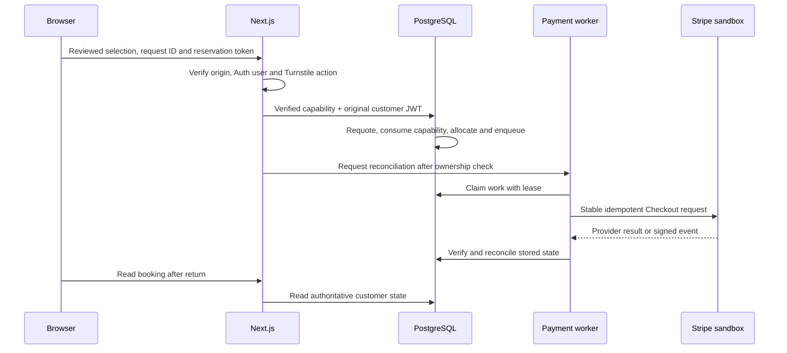

# Architecture

PalmSteeze is a Next.js App Router application backed by Supabase Auth/PostgreSQL and a Supabase Edge payment worker. The browser chooses a visit; the database owns its price, allocation and history.

## Request and payment path

The signed capability lasts 60 seconds and binds the verified user, action, selection, reviewed quote, amount, request ID and origin. Its database wrapper consumes it atomically. The customer JWT remains in force; the application does not replace customer ownership with a service role.

The worker can be called by protected recovery or signed webhooks. Leases coordinate concurrent workers. Retries retain stable provider idempotency parameters and a booking's initiating return origin. An ambiguous response keeps inventory protected until reconciliation establishes what happened.

## Data and invariants

| Data | Purpose |
| --- | --- |
| `venue_settings`, `resources`, `resource_rates` | Opening rules, inventory and effective prices |
| `bookings`, `allocations` | Financial/policy snapshots and active inventory protection |
| `payment_attempts`, `refund_operations`, `payment_refund_receipts` | Provider progress, generations and verified returned amounts |
| `cancellation_requests`, `admin_audit` | Customer requests, decisions and attributable history |
| Private roles, jobs, events and authorization tables | Privileged roles, durable recovery, deduplication and capability consumption |

Money is integer kobo, with naira formatting and exact decimal parsing at the interface. Current quotes use a 40% minimum deposit; old snapshots remain unchanged. Active resource intervals are half-open and protected by a GiST exclusion constraint. RLS restricts customer reads; administration requires an explicit role.

Migration order matters. Later SQL replaces earlier functions, so read the latest definition before changing an RPC. `scripts/database.ts` checks recorded SHA-256 values and applies forward migrations transactionally. Do not rewrite applied files or reset retained records.

## Authentication and browser state

`src/proxy.ts` handles entrance gating and refreshes existing Supabase cookies. Routes still verify identity with Auth. `/auth/sign-in` starts Google OAuth through Supabase with PKCE; `/auth/callback` exchanges the code and uses an allowlisted destination saved before the redirect.

Entrance clearance, Google identity and reservation authorization are independent. Signed preferences last 180 days; optional visit drafts use tab-scoped `sessionStorage`. Withdrawal clears those drafts. Query parameters do not supply trusted money, roles or confirmation.

## Where to make changes

| Path | Responsibility |
| --- | --- |
| `src/app/` | Pages, server rendering, legal routes and APIs |
| `src/components/workspace-explorer.tsx` | Planner and availability requests |
| `src/components/checkout-actions.tsx` | Quote review, Checkout and cancellation interactions |
| `src/components/workspace-experience.tsx` | Video lifecycle, responsive sources and reduced-motion posters |
| `src/components/ui/` | Cards, grouped selects, calendar and popup behavior |
| `src/lib/` | Money/dates, Auth destinations, origins, catalog and verified presentation |
| `supabase/migrations/` | Ordered database contracts and permission changes |
| `supabase/functions/` | Webhook/recovery worker and shared exact-origin configuration |
| `scripts/` | Runtime, database, verification, media export and release tooling |
| `tests/unit`, `tests/database`, `tests/browser` | Pure logic, database/role proofs and browser journeys |

Three.js and Anime.js render the workspace scene offline. The public section imports no scene renderer: it plays the committed MP4 variants. See [assets](assets.md) and [development](development.md).
